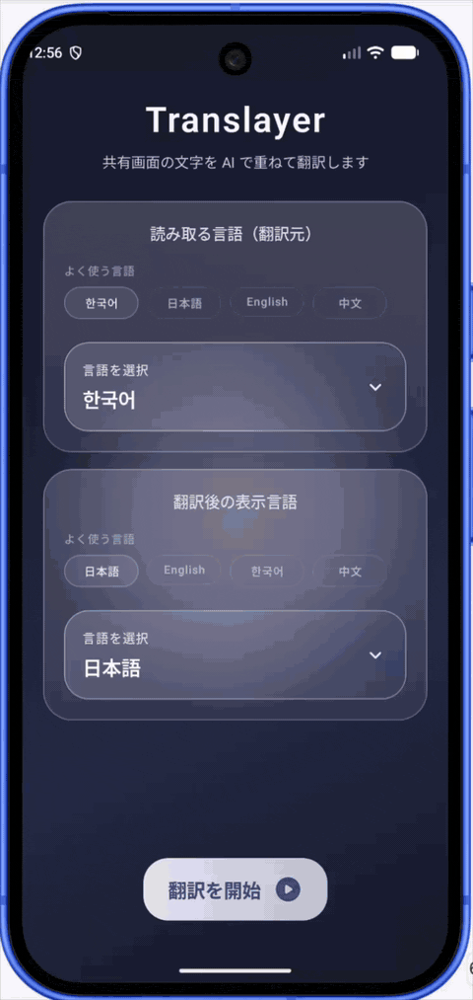
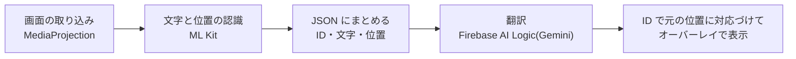

# Translayer

インスタなどで外国語の漫画を読むとき、アプリを切り替えずにその場で読めるようにする Android アプリ。画面上の文字を認識し、Gemini で翻訳して、元の文字の位置に重ねて表示する。

## デモ

フローティングボタンを押すと、表示中の画面の文字を翻訳し、吹き出しや見出しの位置にそのまま重ねて表示する(デモの漫画は、このために用意したもの)。

## 主な機能

- **画面の翻訳**: 画面の取り込み(MediaProjection)で表示中の内容を読み取り、その場で翻訳する
- **元の位置に重ねて表示**: 翻訳を元の文字の位置に重ねるので、視線を動かさずに読める
- **言語の選択**: 翻訳元と翻訳先の言語を選べる。最近使った言語はすぐに選び直せる
- **自動で閉じる**: アクセシビリティサービスでアプリの切り替えを検知し、翻訳していたアプリから離れたら翻訳の UI を閉じる

## 仕組み

1. ML Kit で文字のかたまりごとに文字と位置を認識する。翻訳元の言語に合わせて認識器(日本語・韓国語・中国語・デーヴァナーガリー・ラテン文字)を切り替える
2. 位置は画面の大きさに対する 0〜1000 の値にそろえ、ID・文字と一緒に JSON にまとめる
3. Firebase AI Logic で Gemini に翻訳させる。出力は JSON のスキーマで `{ID, 翻訳}` の配列に固定し、ID で元の位置に戻す
4. 翻訳をオーバーレイで元の位置に重ねて表示する

## 工夫したこと

- **出力の形を固定する**: 自由な文章で返させると、どの翻訳がどの吹き出しのものか分からなくなる。JSON のスキーマを指定し、ID で元の位置と対応づけている
- **アプリを更新せずに調整できる**: プロンプト、モデル名、出力の上限、temperature を Firebase Remote Config で管理し、アプリの既定値でも動くようにしている
- **API の不正利用を防ぐ**: Firebase App Check(release は Play Integrity)で、正規のアプリからだけ Gemini を呼べるようにしている。トークンは使い捨て(limited-use)にしている
- **速さを優先する**: 翻訳は軽量なモデル(既定は `gemini-3.1-flash-lite`)を使い、思考の量を最小にしている

## 技術スタック

| 分野 | 技術 |
|---|---|
| UI | Jetpack Compose (Material 3) |
| 非同期処理 | Kotlin Coroutines / Flow |
| DI | Hilt |
| 文字の認識(OCR) | ML Kit Text Recognition |
| 翻訳 | Firebase AI Logic(Gemini Developer API) |
| 設定・セキュリティ | Firebase Remote Config、Firebase App Check、Firebase Analytics |
| アーキテクチャ | MVVM + Repository |

## セットアップ

1. **Firebase のプロジェクトを作る**
    - [Firebase Console](https://console.firebase.google.com/) でプロジェクトを作る
    - `google-services.json` を `app/` に置く
2. **Firebase AI Logic を有効にする**
    - Firebase Console の AI Logic で、Gemini Developer API を有効にする
    - Remote Config はアプリに含まれる既定値(`app/src/main/res/xml/remote_config_defaults.xml`)で動く。アプリを更新せずにプロンプトやモデルを変えたいときだけ、同じ名前のキーを Firebase Console で設定する
3. **Firebase App Check を設定する**
    - release ビルドは Play Integrity を使う。Firebase Console で App Check を設定する
    - App Check を強制した状態で debug ビルドを動かすときは、Logcat に出るデバッグトークンを Firebase Console の **App Check > Apps > Manage debug tokens** に登録する。トークンはリポジトリに保存しない
4. **ビルドする**
    - Android Studio でプロジェクトを開いてビルドする

## 必要な権限

- **他のアプリの上に重ねて表示**: 翻訳をオーバーレイで表示するため
- **アクセシビリティサービス**: 前面のアプリの切り替えを検知し、翻訳の UI を閉じるため
- **画面の取り込み**: 画面上の文字を読み取るため。使うたびに許可を求める
