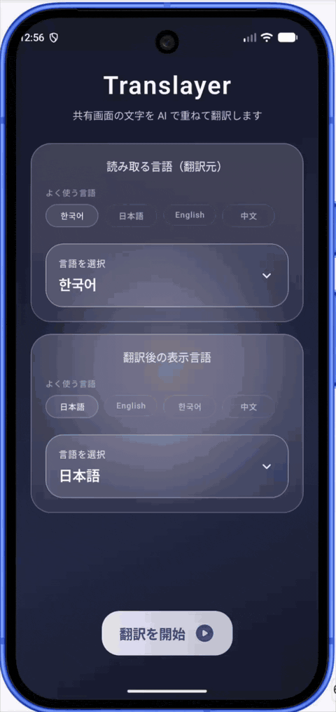
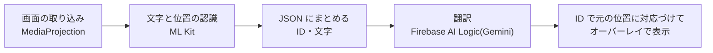
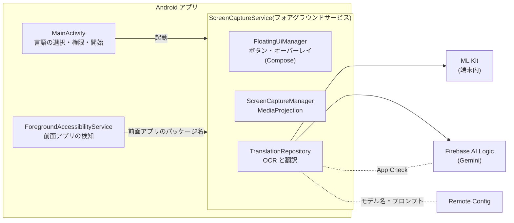

# Translayer

インスタなどで外国語の漫画を読むとき、アプリを切り替えずにその場で読めるようにする Android アプリ。画面上の文字を認識し、Gemini で翻訳して、元の文字の位置に重ねて表示する。

このリポジトリはデモと設計の紹介用で、ソースコードは非公開。

## デモ

フローティングボタンを押すと、表示中の画面の文字を翻訳し、吹き出しや見出しの位置にそのまま重ねて表示する(デモの漫画は、このために用意したもの)。

## 主な機能

| 機能 | 内容 |
|---|---|
| 画面の翻訳 | 画面の取り込み(MediaProjection)で表示中の内容を読み取り、フローティングボタンを押すとその場で翻訳する |
| 元の位置に重ねて表示 | 翻訳を元の文字の位置に重ねるので、視線を動かさずに読める |
| 言語の選択 | 翻訳元と翻訳先の言語を選べる。最近使った言語はすぐに選び直せる |
| 自動で閉じる | アクセシビリティサービスでアプリの切り替えを検知し、翻訳していたアプリから離れたら翻訳の UI を閉じる |
| 原因に合ったエラー表示 | 文字が見つからない、オフライン、タイムアウト、出力が途中で切れた、サービス側の障害などを区別して、それぞれ別のメッセージを出す |

## 仕組み

1. MediaProjection の `ImageReader` から画面を取り出し、長い辺が 2048px 以下になるよう縮小する
2. ML Kit で文字のかたまりごとに文字と位置を認識する。翻訳元の言語に合わせて認識器(日本語・韓国語・中国語・デーヴァナーガリー・ラテン文字)を切り替える
3. 位置は画面の大きさに対する 0〜1000 の値(`[top, left, bottom, right]`)にそろえて手元に残し、Gemini には ID と文字だけを JSON で送る
4. 出力は JSON のスキーマで `{id, text}` の配列に固定し、ID で元の位置に戻す
5. 翻訳をオーバーレイで元の位置に重ねて表示する

## 全体構成

### この構成にした理由

| 決めたこと | 理由 |
|---|---|
| 翻訳の処理は Activity ではなく**フォアグラウンドサービス**で動かす | 翻訳したいのは他のアプリを表示しているときなので、このアプリの画面が閉じていても動き続ける必要がある。サービスを `LifecycleService` にし、`WindowManager` のオーバーレイに Compose で描画している |
| Gemini には**位置を送らず**、位置は常に OCR の結果を使う | モデルに座標を返させると、ずれたり欠けたりしたときに翻訳が別の場所に出てしまう。ID と文字だけを送り、返ってきた翻訳を ID で OCR の位置に差し込む。送る量も減る |
| 出力の形を **JSON のスキーマ**で固定し、スキーマはコードから生成する | 自由な文章で返させると、どの翻訳がどの吹き出しのものか分からなくなる。スキーマは Kotlin のクラスから KSP(`@Generable`)で生成し、応答もそのクラスで直接受け取るので、スキーマと型を二重に管理しない |
| 結果を **sealed interface** で返し、失敗の種類を分ける | 以前は失敗がすべて空のリストになり、通信の失敗でも「文字が見つからない」と表示されていた。今は「文字なし・出力が切れた・応答が不正・オフライン・タイムアウト・サービス側の障害・その他」を別の型にし、それぞれ別のメッセージを出す |
| オフラインなら **OCR の前に止める** | OCR は端末内で動くが、翻訳には通信が要る。無駄な処理をせず、すぐにオフラインだと伝える |
| モデルの設定を **Remote Config** で管理する | プロンプト、モデル名、出力の上限、temperature をアプリの更新なしで変えられる。値は読むたびに確かめ、変わっていたらモデルを作り直す。アプリに入れた既定値だけでも動く |
| **App Check** を使い、トークンは使い捨てにする | 正規のアプリからだけ Gemini を呼べるようにする(release は Play Integrity)。トークンは limited-use にし、盗まれても使い回されにくくする |
| オーバーレイを閉じたら**翻訳をキャンセル**する | 閉じた後に結果が出てくると邪魔になる。コルーチンのジョブを取り消し、`CancellationException` は他の例外と一緒に握りつぶさずに投げ直す |
| 速さを優先する | 翻訳は軽量なモデル(既定は `gemini-3.1-flash-lite`)を使い、思考の量を最小にしている。タイムアウトは既定の 180 秒から 30 秒に短くし、電波が悪いときにローディングが長く続かないようにした |

## 開発の進め方

| 仕組み | 内容 |
|---|---|
| CLAUDE.md | アーキテクチャと、壊しやすい決まり(位置は OCR のものを使う、失敗は新しい型として足す、など)を書き、AI が作業前に読む |
| 編集時の自動整形 | Claude Code のフックで、AI が編集した Kotlin のファイルに `ktlint --format` をかける |
| CI | PR ごとに ktlint・detekt・Android Lint・単体テスト・debug ビルドを実行する |
| AI レビュー | PR を出すと、実装した AI とは別の Claude が CLAUDE.md の決まりに沿って自動でレビューする。コードスタイルは CI に任せ、正しさ・決まりとの食い違い・Android 固有の問題・セキュリティを見る |

## 技術スタック

| 分野 | 技術 |
|---|---|
| UI | Jetpack Compose (Material 3) |
| 非同期処理 | Kotlin Coroutines / Flow |
| DI | Hilt |
| 文字の認識(OCR) | ML Kit Text Recognition |
| 翻訳 | Firebase AI Logic(Gemini Developer API)、構造化出力(`firebase-ai-ksp-processor`) |
| 設定・セキュリティ | Firebase Remote Config、Firebase App Check、Firebase Analytics |
| アーキテクチャ | MVVM + Repository |
| 品質 | ktlint、detekt、Android Lint、GitHub Actions |

## 必要な権限

- **他のアプリの上に重ねて表示**: 翻訳をオーバーレイで表示するため
- **アクセシビリティサービス**: 前面のアプリの切り替えを検知し、翻訳の UI を閉じるため
- **画面の取り込み**: 画面上の文字を読み取るため。使うたびに許可を求める
