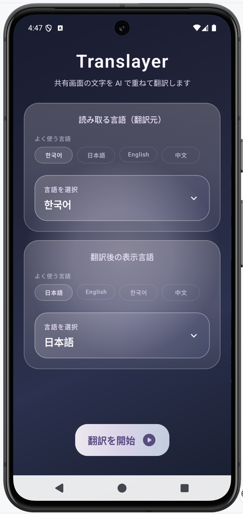
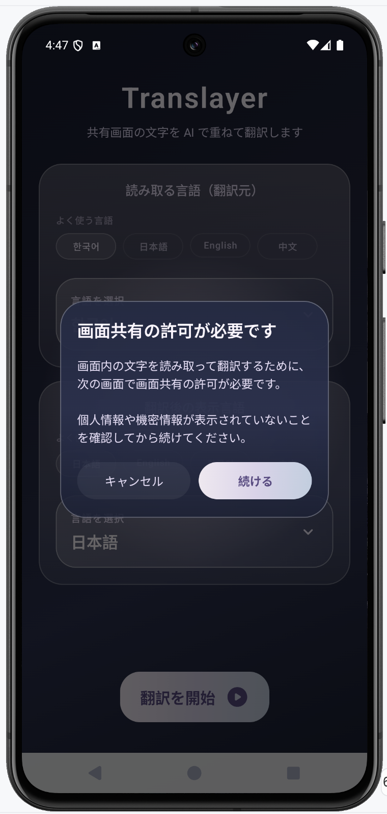
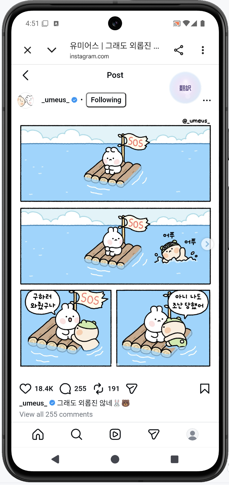
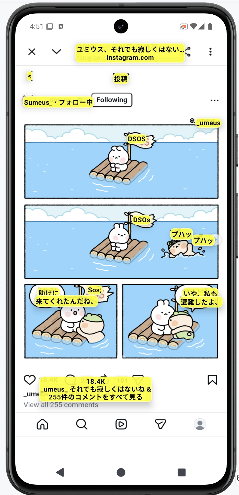
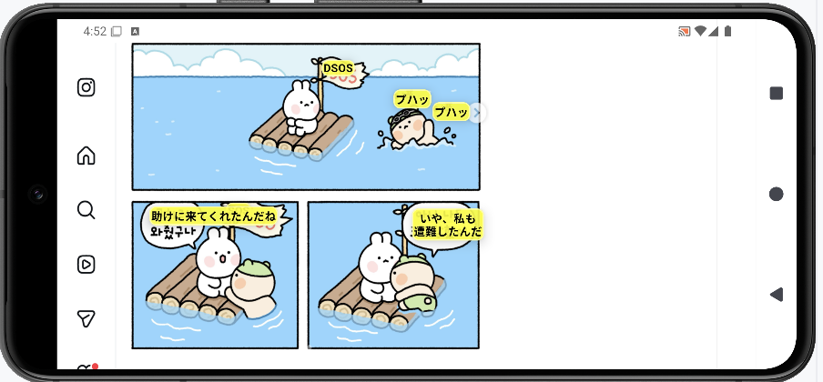

# Translayer

Translayerは、Androidデバイスの画面上にあるテキストをリアルタイムで認識し、AI（Gemini）を活用してその場に重ねて翻訳（オーバーレイ表示）するアプリです。

## 主な機能

- **リアルタイム画面翻訳**: 画面録画（MediaProjection）機能を使用して、表示されている内容を即座に翻訳します。
- **オーバーレイ表示**: 翻訳結果を元のテキストの位置に重ねて表示するため、視線の移動を最小限に抑えられます。
- **AIによる高品質な翻訳**: Firebase Gemini (Google AI) を使用し、文脈に応じた自然な翻訳を提供します。
- **言語選択**: 多数の言語ペアに対応。最近使用した言語はクイック選択から簡単に切り替え可能です。
- **自動終了機能**: アクセシビリティサービスを利用してアプリの切り替えを検知し、別のアプリに移動した際に翻訳UIを適切に制御します。

## スクリーンショット

|              ホーム               |                権限リクエストの説明                 | 
|:------------------------------:|:-----------------------------------------:|
|  |  |

|                   翻訳ボタン                   |                     翻訳表示                     |                          翻訳表示(横向き)                          |
|:-----------------------------------------:|:--------------------------------------------:|:-----------------------------------------------------------:|
|  |  |  |

## 技術スタック

- **UI**: Jetpack Compose (Material 3)
- **非同期処理**: Kotlin Coroutines & Flow
- **依存注入 (DI)**: Hilt
- **OCR (文字認識)**: ML Kit Text Recognition
- **翻訳**: Firebase AI (Gemini Nano / Pro)
- **バックエンド/設定**:
    - Firebase Remote Config (プロンプト制御)
    - Firebase App Check (セキュリティ)
    - Firebase Analytics (利用統計)
- **アーキテクチャ**: MVVM + Repository Pattern

## セットアップ

1. **Firebaseのプロジェクト作成**:
    - [Firebase Console](https://console.firebase.google.com/) でプロジェクトを作成します。
    - `google-services.json` を `app/` ディレクトリに配置します。

2. **APIの有効化**:
    - Google AI (Gemini) APIを有効にします。
    - Firebase Remote Config は、アプリに含まれる既定値で動作します。プロンプトやモデル設定をアプリ更新なしで変更したい場合のみ、`remote_config_defaults.xml` と同名のキーを Firebase Console で設定します。

3. **Firebase App Check**:
    - release ビルドでは Play Integrity を使用します。Firebase Console で App Check を設定します。
    - App Check を強制している状態で debug ビルドを実行する場合は、Logcat に出力されるデバッグトークンを Firebase Console の **App Check > Apps > Manage debug tokens** に登録します。トークンはリポジトリに保存しないでください。

4. **ビルド**:
    - Android Studio でプロジェクトを開き、ビルドします。

## 必要な権限

アプリを正常に動作させるために、以下の権限の許可が必要です：

- **他のアプリの上に重ねて表示**: 翻訳結果をオーバーレイ表示するために必要です。
- **アクセシビリティサービス**: アプリの起動状態を検知し、ユーザー体験を最適化するために使用します。
- **画面録画の許可**: 画面上の文字を読み取るために、実行時に許可を求めます。
